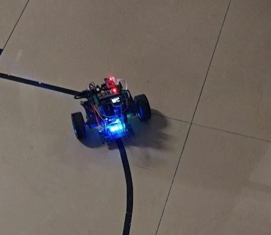
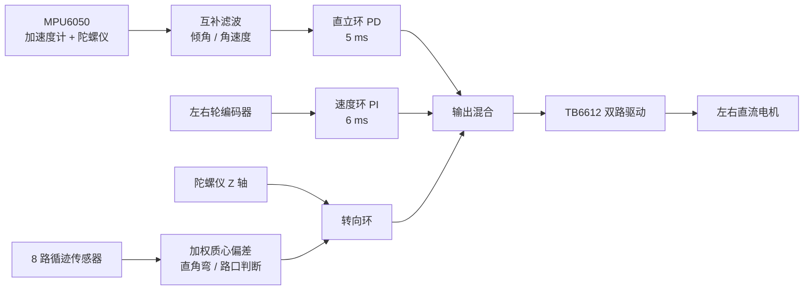
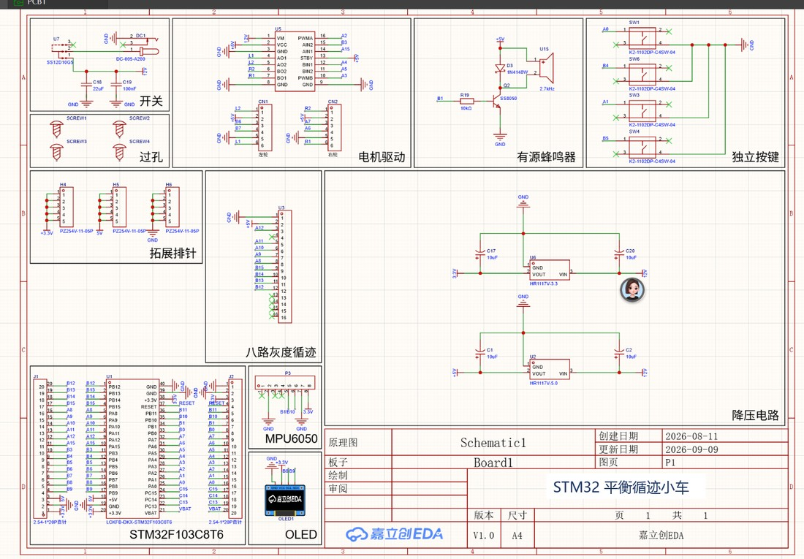
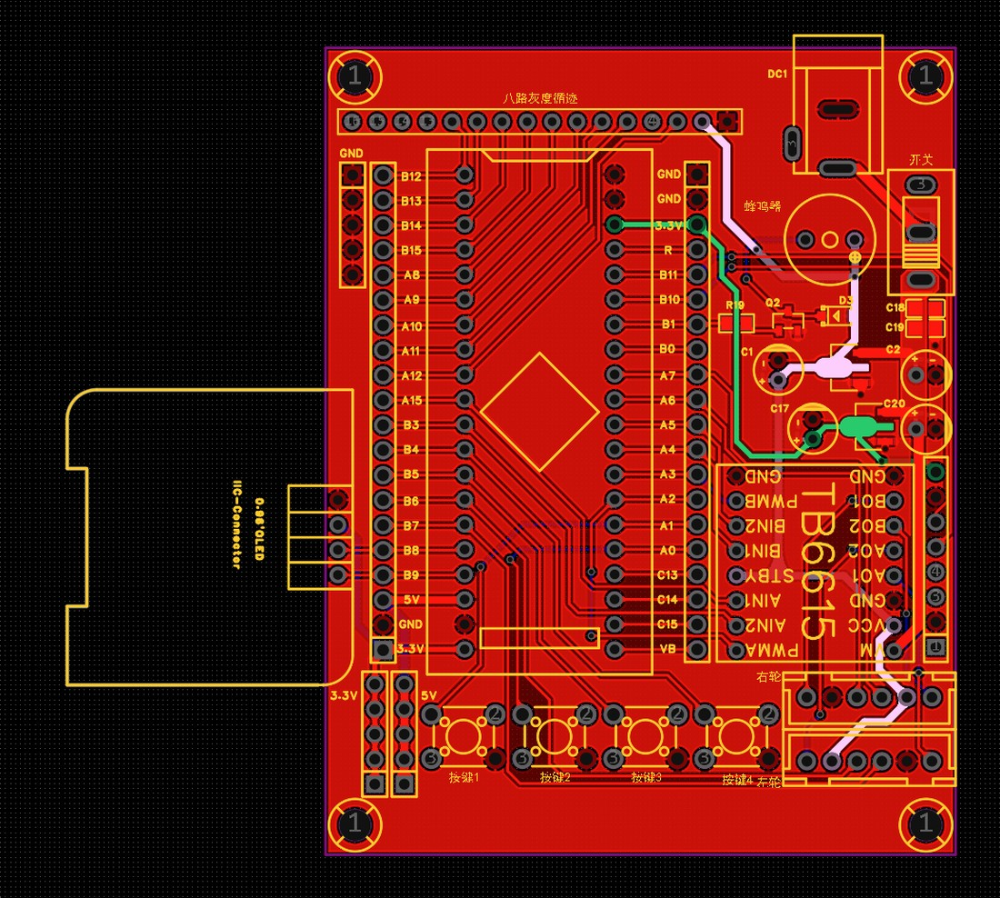

# 基于 STM32F103C8T6 的两轮自平衡循迹小车


> 从画 PCB、焊贴片、写驱动到整定三环 PID 的完整课程项目。  
> 直立环 + 速度环 + 转向环 · MPU6050 姿态融合 · 双路编码器 · 八路循迹 · VOFA+ 实时调参

<p align="center">
  
</p>

## 项目简介

这是一个两轮倒立摆结构的自平衡小车：用 MPU6050 获取车身姿态，通过直立环、速度环、转向环三环控制让小车稳稳站住并前后运动；在平衡的基础上加入八路循迹传感器，让小车能沿着地面黑线行驶，并处理直角弯、十字路口等特殊路况。

项目从硬件到软件完整走了一遍：PCB 用嘉立创 EDA 自己画、自己焊；软件从 MPU6050、编码器、电机、OLED 等底层驱动写起，再搭控制逻辑、调 PID、加循迹。代码里的注释记录了调参时踩过的坑和当时的判断依据。

## 功能一览

| 功能 | 实现方式 |
| --- | --- |
| 自平衡 | MPU6050 互补滤波求倾角，直立环 PD（5 ms 周期）+ 速度环 PI（6 ms 周期） |
| 速度控制 | 左右轮编码器测速，目标速度斜坡软启动，积分限幅、倾角过大时清积分 |
| 转向控制 | 陀螺仪 Z 轴阻尼 + 循迹差速，左右轮输出差速混合 |
| 循迹 | 8 路传感器串行读取，加权质心求偏差，差速跟线；偏差再做一阶低通 |
| 直角弯 | 识别单侧压线图案后锁定方向，固定大差速硬拐 45 帧，期间忽略传感器 |
| 十字路口 | 连续 30 帧（约 0.15 s）八路全黑才判定，停车并回到纯平衡 |
| 调试交互 | OLED 实时显示角度、8 路状态、偏差、速度；按键切换平衡/循迹；VOFA+ 波形与在线调参 |
| 安全保护 | 倾角超过 ±45° 直接断电机；PWM 限幅 ±100；目标速度斜坡 |

## 控制结构



- **TIM4 中断，5 ms**：读 MPU6050 → 互补滤波 → 直立环 PD → 读八路循迹 → 转向环 → 左右轮输出混合 → 电机。
- **TIM1 中断，2 ms**：按键扫描；每 3 次执行一次速度环（6 ms）。
- **主循环**：按键处理、OLED 刷新、串口/VOFA+ 数据发送。

## 硬件与接线

| 模块 | 型号 / 方案 | STM32 引脚 | 说明 |
| --- | --- | --- | --- |
| 主控 | STM32F103C8T6 | — | 72 MHz，64 KB Flash |
| 姿态传感器 | MPU6050 | 软件 I2C：SCL PB10 / SDA PB11 | ±2000 °/s、±16 g，200 Hz 采样 |
| 电机驱动 | TB6612FNG | PWMA PA2 / PWMB PA3 | TIM2 CH3/CH4，20 kHz PWM |
| 左电机方向 | — | PA15 / PB3 | 与 PWM CH3 配合 |
| 右电机方向 | — | PA4 / PA5 | 与 PWM CH4 配合 |
| 左轮编码器 | 增量式编码器 | PA0 / PA1 | EXTI 双边沿，软件正交解码，4 倍频 |
| 右轮编码器 | 增量式编码器 | PA6 / PA7 | TIM3 硬件编码器接口，4 倍频 |
| 八路循迹 | 串行输出灰度/红外模块 | CLK PA11 / DAT PA10 / 校准键 PA12 | 5 ms 读一帧，bit=1 表示压黑线 |
| OLED | 0.96 寸 SSD1306 | 软件 I2C：SCL PB8 / SDA PB9 | 128×64 |
| 按键 | — | PB5 / PB4 | PB5 切换平衡/循迹，PB4 启停 |
| 上位机 | VOFA+ | USART1 重映射 TX PB6 / RX PB7 | 115200，JustFloat 协议 |
| 电源 | 3 节电池 12.6 V | — | 板载 HR1117-5.0 / HR1117-3.3 降压 |

| 原理图（嘉立创 EDA） | PCB 3D 预览 |
| --- | --- |
|  |  |

## 关键实现

### 1. 姿态融合：互补滤波

MPU6050 的加速度计静态准、动态受振动影响；陀螺仪短时响应快、积分会漂。代码用互补滤波把两者融合：

```c
Gyro_Rate = (Gyro_Offset - GY) / 16.4f;              // ±2000 °/s 量程
Acc_Angle = atan2f(AX, AZ) * 57.2958f;               // 加速度计静态倾角
Angle = 0.9f * (Angle + Gyro_Rate * 0.005f) + 0.1f * Acc_Angle;
```

- 每 5 ms 用陀螺仪积分 0.005 s，再拿加速度计角度修正 10%，兼顾响应和长期稳定。
- 上电后连续采 200 组陀螺仪数据求平均，作为静止零偏；D 项直接使用去零偏后的原始角速度，避免额外滤波带来相位滞后。
- 车身装好后重心并不正好在竖直方向，`Angle_Zero` 固定为实测的 `-2.81°`。曾经尝试每次上电自动找零点，但机械位置每次不同，反而导致同一组 PID 参数时好时坏。

### 2. 三环控制：直立、速度、转向

直立环（PD）负责“站住”，速度环（PI）负责“别溜走”，转向环负责“别跑偏”：

```c
Balance_Out = Balance_Kp * Balance_Error - Balance_Kd * Gyro_Rate;
Speed_Out   = Speed_Kp * Speed_Error + Speed_Ki * Speed_ErrorInt;
Turn_Out    = Turn_Kp * (GZ - GZ_Offset) / 16.4f + turn_out;  // 阻尼 + 循迹差速

Base = Balance_Out + Speed_Out;
v_L  = Base - Turn_Out;
v_R  = Base + Turn_Out;
```

几个实际处理：

- **D 项符号**：`Balance_Kd` 取正值，代码里用减号，让阻尼方向和 P 项回正方向一致。符号写反时小车会大幅高频摆动，这是调试中卡得最久的问题。
- **速度环**：编码器误差先做一阶低通（`0.2 * 新 + 0.8 * 旧`）再进积分，P 项仍用原始误差；积分限幅 ±300，倾角超过 ±30° 时清零，防止落地后积分饱和。
- **软启动**：速度目标每个速度环周期最多变化 0.1，避免按键启动时目标从 0 跳到设定值造成前冲。
- **限幅**：直立/速度输出限 ±100，转向输出限 ±50，防止转向差速和直立环抢控制权。
- 速度环输出直接叠加到基础 PWM，效果上相当于给直立环一个倾角偏置；这是本项目实际采用的简化实现。

### 3. 双路编码器：两种解码方式都实现了一遍

- **左轮 PA0/PA1**：两路都开双边沿 EXTI 中断，在中断里比较 A/B 相电平判断方向，软件实现 4 倍频正交解码。
- **右轮 PA6/PA7**：用 TIM3 的硬件编码器接口（`TIM_EncoderMode_TI12`），同样 4 倍频。

之所以左右不一样，是因为画 PCB 时引脚分配受限：左轮没有落到带编码器接口的定时器引脚上，最后用 EXTI 软件解码解决。后来正好把软件解码和硬件编码器两种方案都跑通了。详见 [`Encoder.c`](平衡车代码/Hardware/Encoder.c)。

### 4. 八路循迹：加权质心 + 特殊路况

传感器通过 CLK/DAT 串行输出 8 位状态，每 5 ms 读一帧，`bit = 1` 表示该路压在黑线上。控制上分三层：

1. **求偏差**：把压线几路的位置编号（0~7）求平均，减去中间值 3.5，再乘 100，得到 ±350 的偏差。偏差乘 `Turn_P` 后做一阶低通（`0.95 * 旧 + 0.05 * 新`），避免黑线在探头之间跳变时转向一步一跳。
2. **直角弯**：当图案为 `0x07/0x0F/0x1F/0x3F`（左侧连续压线）或 `0xE0/0xF0/0xF8/0xFC`（右侧连续压线）时，锁定方向并给出固定大差速硬拐 45 帧。锁定期间无论读到全白还是反方向图案都不改变方向，数完自动交回质心循迹。这一步是为了解决直角弯时整排传感器离开黑线、车不知道该往哪拐的问题。
3. **十字路口/终点**：连续 30 帧八路全黑才判定路口，避免颠簸造成的单帧全黑误触发。判定后退出循迹、目标速度归零，但保持直立环工作，车原地站住。

核心代码在 [`main.c`](平衡车代码/User/main.c#L230-L300) 和 [`xunji.c`](平衡车代码/Hardware/xunji.c)。

### 5. 调试交互：OLED + VOFA+ 在线调参

- **OLED**：第一行显示倾角、启停和模式；第二行显示 8 路原始状态；第三行显示偏差；第四行显示实际速度和转向输出。调循迹时不用接上位机，把车放线上看哪几位为 1、左右平移看 1 是否跟着移动即可。
- **VOFA+**：USART1 每帧发送 8 个 float（角度、角速度、直立输出、目标速度、实际速度、速度输出、Kp、Kd），JustFloat 协议，115200。
- **串口命令**：VOFA+ 发送框输入命令可实时改参数，不用反复烧录：

  | 命令 | 作用 |
  | --- | --- |
  | `P3.5` | 修改直立环 `Balance_Kp` |
  | `D0.4` | 修改直立环 `Balance_Kd` |
  | `V5.4` | 修改速度环 `Speed_Kp` |
  | `I0.027` | 修改速度环 `Speed_Ki` |
  | `T0.75` | 修改目标速度 |
  | `S` | 启动 / 停止 |

  实现见 [`bsp_usart.c`](平衡车代码/Vofa/bsp_usart.c) 和 [`vofa_usart.c`](平衡车代码/Vofa/vofa_usart.c)。

### 6. 安全保护

- 倾角超过 ±45° 直接断电机，防止摔倒后电机堵转。
- 速度积分在倾角超过 ±30° 时清零，避免落地后积分饱和导致突然前冲。
- 所有电机输出限幅 ±100，转向差速限幅 ±50。
- 目标速度斜坡软启动，避免按键启动瞬间过冲。

## 调试中踩过的坑

| 现象 | 根因 | 解决 |
| --- | --- | --- |
| 上电后大幅高频摆动 | 直立环 Kd 符号写反，阻尼变成“助振” | 改正 D 项符号，让阻尼与 P 项回正方向一致 |
| 小车越跑越快直到翻车 | 速度环输出与直立环叠加的符号反了 | 统一输出方向，速度环真正起阻碍作用 |
| 按键启动猛地前冲 | 目标速度从 0 一步跳到设定值 | 每个速度环周期最多变化 0.1 的斜坡软启动 |
| 直角弯直接冲出去 | 车头整排传感器离开黑线，全白不知道往哪拐 | 方向锁 45 帧 + 固定大差速 + 降速 |
| 颠一下误判到路口 | 单帧全黑就判定 | 连续 30 帧全黑才确认 |
| 每次上电零点不同 | 机械安装位置和陀螺仪零偏每次都变 | 200 次静止采样求零偏，机械零点固定为 -2.81° |
| 左轮编码器接不到定时器 | PCB 引脚分配受限 | 改用 EXTI 双边沿软件正交解码 |
| 循迹时转向抖动 | 黑线在探头格间跳变，差速一步一跳 | 偏差一阶低通 + 转向限幅 + 降低循迹速度 |

## 测试结果

- **平衡**：扶到接近直立后松手能自己站住；轻推后能回正，重推会先顺着力的方向冲一小段再找回来；静置时前后有少量位移，速度环能慢慢拉回。
- **循迹**：直道能稳定压线，普通弯道能跟着拐；直角弯在低速下可以通过；速度再往上提，直角弯容易甩出去。
- **局限**：车头这一排传感器只能看到眼前一小段线，直角弯必须靠“丢线前记住方向”硬带，速度被迫压得很低。根因不是 PID 参数，而是传感器视野；想提速需要让传感器看得更远、更密，或者换摄像头方案。

完整调试过程和测试记录见 [项目报告（已脱敏）](docs/基于STM32的平衡寻迹小车汇报总结.pdf)。

## 工程结构

```text
.
├── README.md
├── docs/
│   ├── 基于STM32的平衡寻迹小车汇报总结.pdf   # 项目报告（已脱敏）
│   └── images/                                # 实物、PCB、原理图
└── 平衡车代码/
    ├── Project.uvprojx            # Keil MDK 工程
    ├── User/
    │   ├── main.c                 # 主控制逻辑、TIM1/TIM4 中断服务函数
    │   ├── stm32f10x_it.c/.h      # 中断入口
    │   └── stm32f10x_conf.h       # 标准库配置
    ├── Hardware/
    │   ├── MPU6050.c/.h           # MPU6050 驱动
    │   ├── MPU6050_Reg.h          # 寄存器定义
    │   ├── MyI2C.c/.h             # 软件 I2C（MPU6050）
    │   ├── Encoder.c/.h           # 左轮 EXTI 软件解码 + 右轮 TIM3 硬件编码器
    │   ├── Motor.c/.h             # TB6612 方向控制
    │   ├── PWM.c/.h               # TIM2 CH3/CH4，20 kHz
    │   ├── xunji.c/.h             # 八路循迹传感器读取与偏差计算
    │   ├── OLED.c/.h              # OLED 驱动（江协科技库）
    │   ├── OLED_Data.c/.h         # 字库/图像数据
    │   ├── Key.c/.h               # 按键扫描
    │   └── LED.c/.h               # 板载 LED
    ├── System/
    │   ├── Delay.c/.h             # 微秒/毫秒延时
    │   ├── Timer1.c/.h            # 2 ms 定时，速度环
    │   └── Timer4.c/.h            # 5 ms 定时，姿态/直立/循迹
    ├── Vofa/
    │   ├── bsp_usart.c/.h         # USART1 重映射 + 串口命令解析
    │   └── vofa_usart.c/.h        # VOFA+ JustFloat 数据发送
    ├── Start/                     # CMSIS 内核、启动文件、stm32f10x.h（第三方）
    └── Library/                   # STM32F10x 标准外设库 V3.5.0（第三方）
```

## 编译与运行

1. 安装 **Keil MDK 5** 和 **STM32F10x Device Family Pack**。
2. 打开 [`平衡车代码/Project.uvprojx`](平衡车代码/Project.uvprojx)，目标器件为 `STM32F103C8`。
3. 编译（F7），用 ST-Link 通过 SWD 下载。
4. 上电后先让小车静止约 1 秒，完成陀螺仪零偏校准；按 **PB4** 启动/停止，按 **PB5** 在平衡和循迹之间切换。
5. 需要看波形时，把 USART1（PB6/PB7）接 USB 转串口，打开 VOFA+，波特率 115200，协议选 JustFloat。

## 主要参数

| 参数 | 当前值 | 说明 |
| --- | --- | --- |
| `Balance_Kp` / `Balance_Kd` | 2.31 / 0.41 | 直立环 PD |
| `Speed_Kp` / `Speed_Ki` | 5.4 / 0.027 | 速度环 PI |
| `Turn_Kp` | 0.4 | 陀螺仪 Z 轴转向阻尼 |
| `Turn_P` | 0.08 | 循迹偏差转差速系数 |
| `Line_Speed` | 0.75 | 循迹目标速度（编码器单位） |
| `Angle_Zero` | -2.81° | 车身机械零点 |
| `Angle_Limit` | 45° | 倒地保护阈值 |
| PWM 频率 | 20 kHz | TIM2，ARR=99，PSC=35 |

> 参数和车体质量、重心、轮胎、电池电压都有关，换车或改结构后需要重新整定。

## 第三方库与参考

- **STM32F10x Standard Peripheral Library V3.5.0**、CMSIS Cortex-M3 内核与启动文件：STMicroelectronics。
- **OLED 驱动与字库**：江协科技（jiangxiekeji.com），本项目在其基础上按自己的显示需求修改。
- **MPU6050 寄存器定义**：参考江协科技 MPU6050 教程整理。
- 主控制逻辑、编码器/电机/PWM/循迹/USART/VOFA+ 驱动与联调、PID 参数整定、PCB 设计均为本人完成。

代码和报告仅供学习交流，第三方库版权归原作者所有。

## 后续可以改进的地方

- 循迹传感器往前伸、增加路数或换摄像头，解决直角弯视野不足导致的低速限制。
- 互补滤波换成卡尔曼滤波，进一步改善动态姿态估计。
- 加入电池电压补偿或电流环，减少电量下降后参数漂移。
- 陀螺仪零偏在线估计，改善长时间运行后的漂移。
- PCB 重新分配编码器引脚，左右轮统一用定时器硬件编码器接口。
